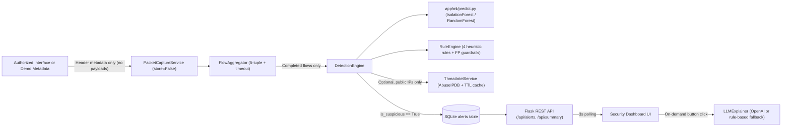
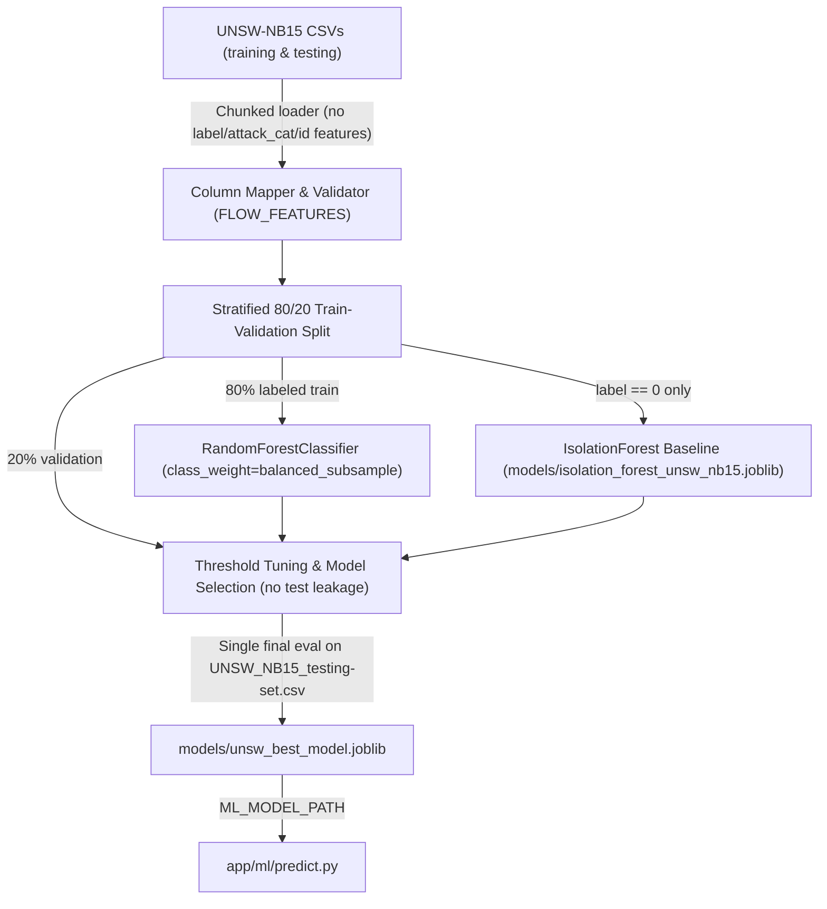
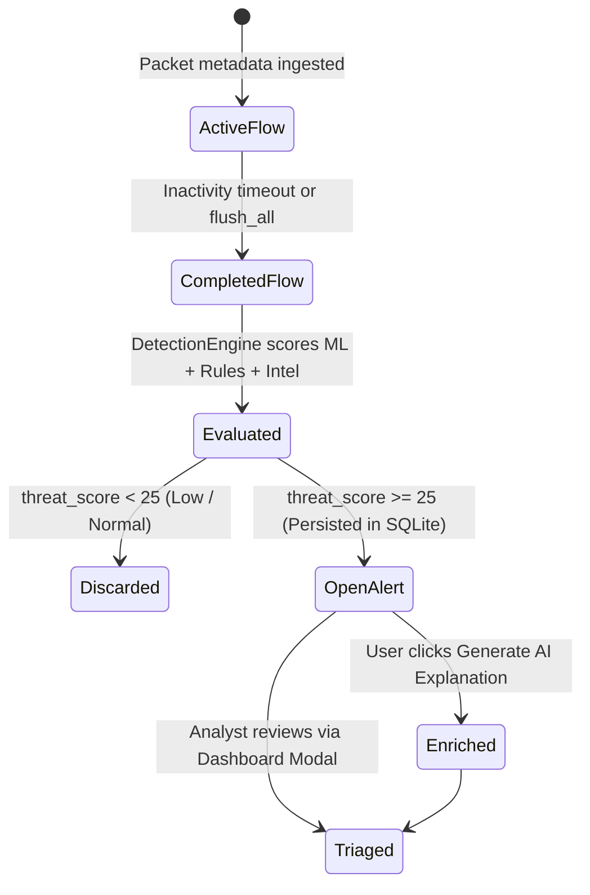

# NetSentinel AI — System Architecture

NetSentinel AI is a modular, privacy-conscious network threat-detection platform built around metadata-only packet inspection, bidirectional flow aggregation, hybrid ML + heuristic detection, optional external enrichment, and a live Flask/Chart.js dashboard.

## 1. System Architecture

The application is organized into four cleanly separated layers:

- **Ingestion & Aggregation (`app/services/packet_capture.py`, `app/services/flow_aggregator.py`):**
  - `PacketCaptureService` captures packet headers only via Scapy (`store=False`) when explicitly authorized (`--live`), ignoring payload bytes and unsupported frames.
  - `FlowAggregator` groups packet metadata into bidirectional 5-tuple flows (`source_ip`, `destination_ip`, `source_port`, `destination_port`, `protocol`) and computes the 11 normalized `FLOW_FEATURES`.
- **Detection & Enrichment (`app/services/detection_engine.py`, `app/services/rule_engine.py`, `app/ml/`, `app/services/threat_intel.py`, `app/services/llm_explainer.py`):**
  - `DetectionEngine` evaluates **completed flows** only by combining local ML inference (`IsolationForest` or `RandomForestClassifier` via `app/ml/predict.py`), transparent heuristic rules (`RuleEngine`), and optional AbuseIPDB reputation (`ThreatIntelService`).
  - `LLMExplainer` generates structured 5-field explanations on demand from strictly sanitized metadata, falling back deterministically when `OPENAI_API_KEY` is unconfigured.
- **Persistence & Web API (`app/__init__.py`, `app/models.py`, `app/routes.py`, `app/validators.py`):**
  - Flask application factory initializes SQLite via Flask-SQLAlchemy, sets defensive HTTP security headers, and exposes `/health`, `/api/alerts`, `/api/alerts/<id>/explain`, `/api/summary`, and `/api/threat-intel/<ip>`.
  - Flask startup **never** auto-starts packet capture.
- **Dashboard UI (`app/templates/dashboard.html`, `app/static/js/dashboard.js`, `app/static/css/style.css`):**
  - Polls `/api/summary` and `/api/alerts` every 3 seconds with a Start/Stop Monitoring toggle, severity/status/IP filters, Chart.js severity distribution, and an alert details modal using safe DOM APIs (`textContent`, `createElement`, `replaceChildren`).

## 2. Data Flow

1. **Packet Metadata Extraction:** Scapy inspects only layer headers (`IP`/`IPv6`, `TCP`/`UDP`/`ICMP`) to extract `timestamp`, `source_ip`, `destination_ip`, `source_port`, `destination_port`, `protocol`, `packet_length`, and `tcp_flags`. Raw application payloads are never read or stored.
2. **Bidirectional Flow Aggregation:** `FlowAggregator` maintains active flows keyed by canonical undirected 5-tuple while preserving the initiator's `source_ip` and `destination_ip`. Flows expire after `inactivity_timeout` seconds (`flush_expired()`) or at shutdown (`flush_all()`).
3. **Completed-Flow Analysis:** `MonitoringService` forwards only completed flows to `DetectionEngine.analyze_flow()`. Active in-progress flows are never scored prematurely.
4. **Persistence:** Normal baseline flows (`threat_score < 25.0`, `severity == "low"`) are discarded without creating database rows. Suspicious flows (`threat_score >= 25.0`) are persisted as `Alert` records in SQLite.

## 3. ML Workflow

All models operate on the exact 11 features defined in `app/ml/feature_schema.py`:
`duration`, `protocol`, `source_port`, `destination_port`, `flow_bytes`, `flow_packets`, `forward_packets`, `backward_packets`, `average_packet_size`, `packet_rate`, and `byte_rate`.

- **Active Model Selection:** Controlled via `ML_MODEL_PATH` (defaulting to `models/isolation_forest.joblib` if unset, or pointed to `models/isolation_forest_unsw_nb15.joblib` or `models/unsw_best_model.joblib`).
- **Unified Prediction Contract:** `predict_flow()` returns `{"anomaly_score": <float>, "prediction": "normal" | "anomaly", "confidence": <float>}` regardless of whether an `IsolationForest` or `RandomForestClassifier` bundle is loaded.

## 4. Alert Lifecycle

1. **Detection & Guardrails:** `RuleEngine` and `DetectionEngine` dampen mild ML deviations on established bidirectional HTTPS (`ACK`/`PA` flags on standard web ports), prevent `high_packet_rate` alone from exceeding `medium` severity, and require at least two independent indicators for `critical` severity.
2. **Triage:** Analysts view live alerts in the dashboard, filter by severity/status/IP, inspect source-IP reputation via `GET /api/threat-intel/<ip>`, and optionally trigger `POST /api/alerts/<id>/explain` for a structured 5-part explanation without altering risk scores.
